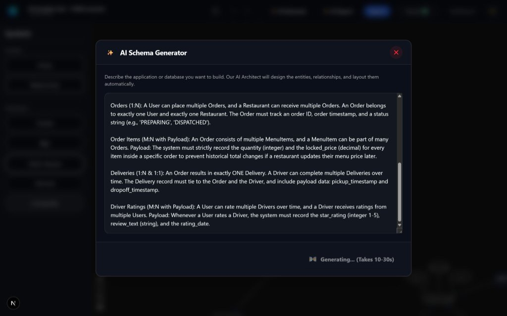
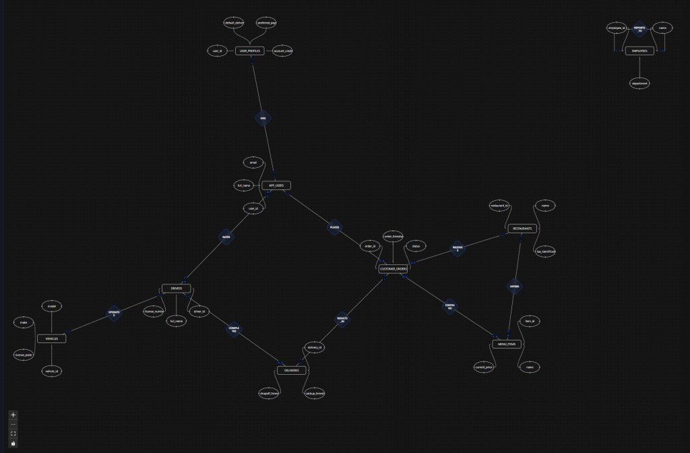
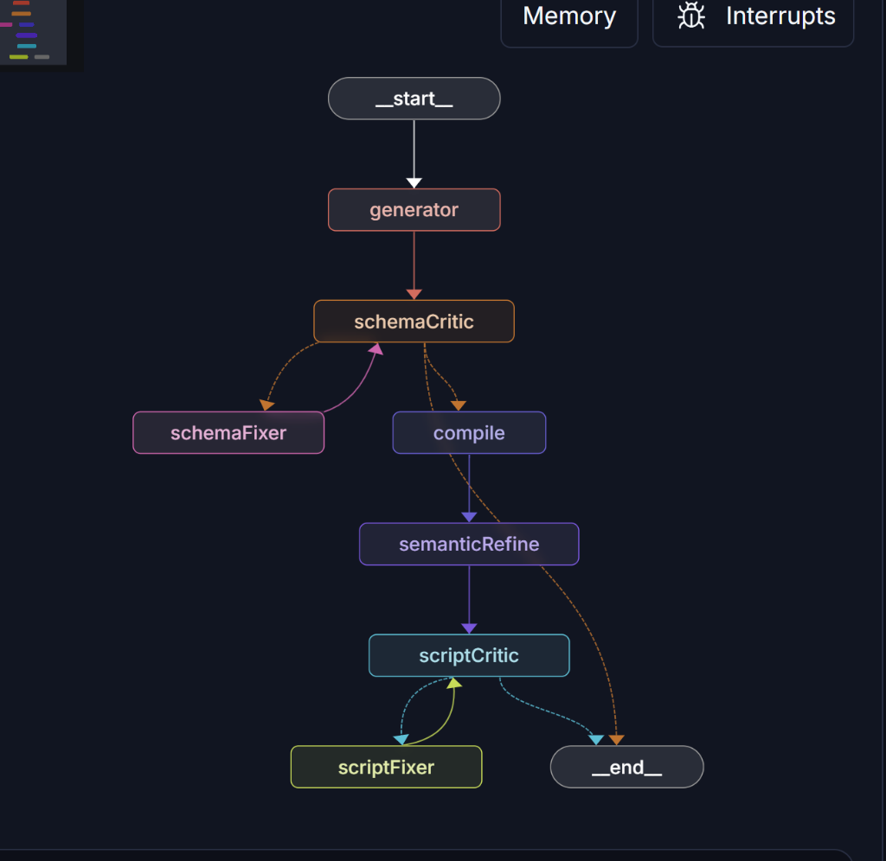

# DB Designer 🚀

> **The First Fully Automated Entity-Relationship (ER) & Relational Compiler built on Chen Notation.**  
> Describe your system requirements in plain English, and our AI Architect instantly designs the conceptual ER diagram, computes the spatial layout, and compiles semantically refined SQL & Prisma schemas.

<video src="assets/demo.mp4" autoplay loop muted playsinline width="100%"></video>

---

## 📸 Showcase: From Scenario to Production Schema

Describe your system rules, entities, and cardinality — the AI Architect generates the complete conceptual Chen schema and arranges every node automatically without manual drawing.

| 1. Input Scenario Prompt | 2. AI-Generated Conceptual ER Diagram |
| :---: | :---: |
|  |  |

---

## 🚀 Core Features

### ✨ AI-Powered Architecture (V2)
* **Natural Language to ER Diagram:** Describe your requirements in plain English; our autonomous agent extracts entities, cardinality (1:1, 1:N, M:N), attributes, and associative payload data strictly following **Chen's Database Notation**.
* **Semantic SQL Refinement:** Naturalizes robotic variable names (e.g., `office_located_room_num` ➔ `room_number`) and resolves foreign key execution order and cyclic dependencies.
* **Deterministic Layout (ELK.js):** Replaces token-heavy LLM coordinate guessing with ELK.js, mathematically computing optimal spatial coordinates in milliseconds.

### 🛠️ Visual Canvas & Autonomous Relational Compiler (V1)
* **Interactive Infinite Canvas:** Full architectural flexibility to sketch or refine schemas manually using React Flow.
* **Abstract Syntax Tree (AST) Compiler:** Uses a recursive graph flattening algorithm crawling visual nodes and edges into a compiled relational schema.
* **Autonomous Normalization (1NF):** Automatically identifies multi-valued attributes and isolates them into First Normal Form child tables with composite primary keys.
* **Associative Junction Table Generation:** Provisions required junction tables for Many-to-Many (M:N) relationships, preserving payload data.
* **Derived State Ignorance:** Visually represents derived attributes (e.g., `age` from `dob`) while intentionally omitting them from physical DDL to save storage.
* **Multi-Dialect Code Generation:**
  * **MySQL:** Standard relational DDL.
  * **PostgreSQL:** Production-ready Postgres DDL.
  * **Oracle SQL:** Enterprise formatting with Oracle datatypes and syntax.
  * **Prisma ORM:** Full-stack schema generation, including dynamically calculated bidirectional back-relations.
* **Zod Gatekeeper:** Strict validation engine catching missing datatypes, duplicate tables/columns, and SQL reserved word conflicts (e.g., `USER`, `ORDER`, `GROUP`).

---

## 🧠 System Architecture & Agent Pipeline

Under the hood, DB Designer runs a multi-stage **LangGraph** agent workflow paired with deterministic validation loops and mathematical graph layout engines:



### The LangGraph Agent Pipeline
1. **Generator Node (`generator`):** Employs structured LLM outputs to generate conceptual Chen schemas without premature junction entities on canvas.
2. **Schema Critic 🔁 Fixer Loop (`schemaCritic` / `schemaFixer`):**
   * Deterministic Zod and relational logic validate primary keys, reserved words, and relationship structures.
   * If issues are identified, the state loops to `schemaFixer` with exact feedback for targeted self-correction.
3. **Compiler Node (`compile`):** Translates validated conceptual graph models into raw SQL scripts.
4. **Semantic Refiner (`semanticRefine`):** Polishes naming conventions and checks for cyclic foreign key issues.
5. **Script Critic 🔁 Fixer Loop (`scriptCritic` / `scriptFixer`):** Final deterministic gatekeeper ensuring syntax and structural safety.

### 🛡️ Resilient System Design Highlights
* ⚡ **Semantic Prompt Caching (Upstash Vector):** Caches prompt embeddings with Gemini embeddings. Similar scenarios ($\ge 90\%$ cosine similarity) are served instantly from cache, saving token usage and latency.
* 🔄 **Multi-LLM Fallback Chain (Gemini ➔ Groq ➔ OpenAI):** Cascades requests across providers to prevent API rate limits or model outages from interrupting users.
* 📈 **Production Observability (LangSmith):** Full pipeline tracing for every LLM call, criticism loop, and node transition.
* 🛡️ **Circuit Breakers:** Restricts recursive self-correction to a maximum of 3 retries to prevent infinite LLM hallucination loops.

---

## ⚒️ Tech Stack

* **Frontend:** Next.js (App Router), React 19, Tailwind CSS v4, Framer Motion, Radix UI / Shadcn
* **Visual Canvas:** React Flow (`@xyflow/react`), ELK.js (`elkjs`)
* **AI & Agent Pipeline:** LangGraph (`@langchain/langgraph`), LangSmith, Google GenAI, Groq, OpenAI
* **Vector & Caching:** Upstash Vector
* **State Management & Validation:** Zustand, Zod
* **Database & ORM:** PostgreSQL / MySQL with Prisma ORM

---

## 🏁 Getting Started

### Prerequisites
* Node.js 20+
* npm or pnpm
* Database (PostgreSQL or MySQL)

### Setup

1. **Clone the repository:**
   ```bash
   git clone https://github.com/innovate-with-ravi/db_designer.git
   cd db_designer
   ```

2. **Install dependencies:**
   ```bash
   npm install
   ```

3. **Configure Environment Variables:**
   Create a `.env` file in the root directory:
   ```env
   DATABASE_URL="your-database-connection-string"
   NEXTAUTH_SECRET="your-nextauth-secret"
   NEXTAUTH_URL="http://localhost:3000"

   # AI & Embeddings
   GEMINI_API_KEY="your-gemini-api-key"
   GROQ_API_KEY="your-groq-api-key"
   OPENAI_API_KEY="your-openai-api-key"

   # Vector Cache & Tracing
   UPSTASH_VECTOR_REST_URL="your-upstash-vector-url"
   UPSTASH_VECTOR_REST_TOKEN="your-upstash-vector-token"
   LANGSMITH_API_KEY="your-langsmith-api-key"
   ```

4. **Run Database Migrations & Generate Prisma Client:**
   ```bash
   npx prisma db push
   npx prisma generate
   ```

5. **Start Development Server:**
   ```bash
   npm run dev
   ```
   Open [http://localhost:3000](http://localhost:3000) to view the application.

---

## 🎥 Complete ER Scratching Demo

[](https://youtu.be/knUu1S7z_y0)

*▶️ [Watch the Complete ER Scratching Demo on YouTube](https://youtu.be/knUu1S7z_y0)*

